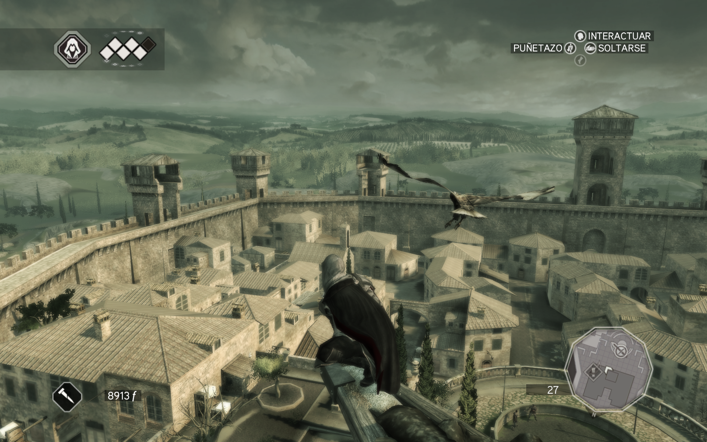
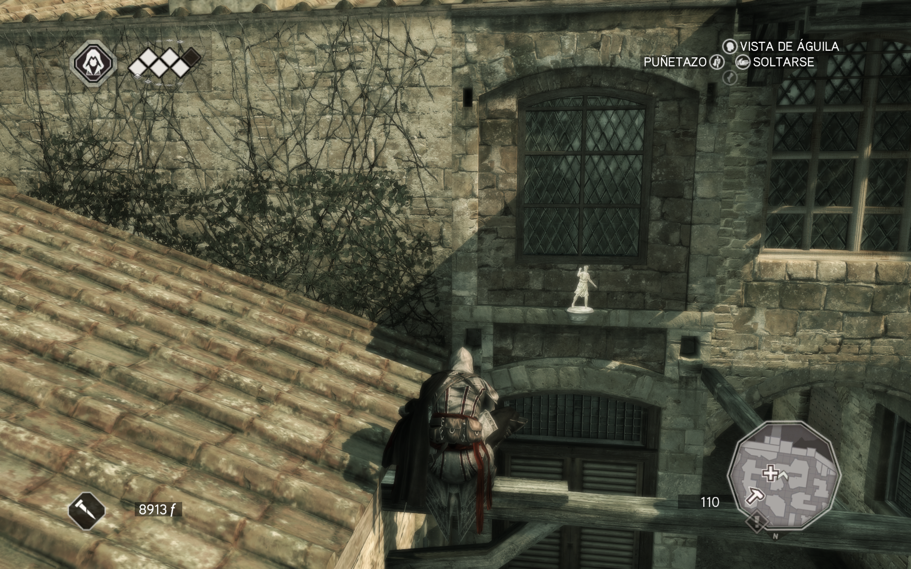

# Assassin’s Creed II Enhanced Patch

A community patch for the Windows Steam edition of Assassin’s Creed II. It adapts gameplay and the interface to your display, supports refresh rates above 60 Hz, and adds native integration for supported PlayStation and Xbox controllers.

[Download the latest preview](https://github.com/XssentialPilar/Assassins-Creed-II-enhanced-patch/releases/tag/v1.1.0-preview.7) · [Download the stable release](https://github.com/XssentialPilar/Assassins-Creed-II-enhanced-patch/releases/latest) · [Installation](#installation) · [Compatibility](#compatibility)

The Windows installer and the new input features described below are available in **v1.1.0-preview.7**.

## What the patch changes

- **Display and interface.** Gameplay fills the selected resolution. HUD elements retain their proportions, the minimap fills its frame, and the shop and weapon-wheel overlays extend to the screen edges.
- **Pre-rendered video.** Videos retain their original proportions. Their surrounding backgrounds extend to fill the display.
- **High refresh rates.** Selecting a refresh rate above 60 Hz removes the game’s internal 60 FPS wait. Your display settings, VSync, and system performance still affect the frame rate you see.
- **Controller support.** The patch identifies supported DualShock 3, DualShock 4, DualSense, and Xbox controllers and shows each family's button icons. Each supported button has a pressed state based on the physical input. DualShock 3 uses colored symbols with START and SELECT. DualSense uses monochrome symbols with Create and Options.
- **Keyboard and mouse prompts.** Supported menus and the gameplay action HUD show the active bindings in round, translucent prompts. A pressed key uses a light background with a dark legend. Press **Ctrl + Alt + F11** while the game is focused to switch between assigned keys and the original icons. The patch displays a confirmation in-game and remembers your choice.

Editable artwork is included for each input family. [Keyboard and mouse](assets/prompts/keyboard-mouse.svg) · [DualShock 3](assets/prompts/dualshock-3.svg) · [DualShock 4](assets/prompts/dualshock-4.svg) · [Xbox](assets/prompts/xbox.svg) · [DualSense](assets/prompts/dualsense.svg)

*The patch’s rendered prompts with default PC bindings. Remapping a key updates its prompt after the game saves the binding.*

## In-game screenshots

*Monteriggioni at 1920 × 1200 (16:10). The action prompts and minimap align with the right side of the display.*

| Action prompts and minimap at 1920 × 1200 | Weapon wheel overlay at 1440 × 1080 |
| --- | --- |
|  |  |

## Installation

The patch supports Steam app **33230**, Windows build **1843459**.

### Windows setup

When a release includes a setup ZIP, extract it and run the versioned setup executable. Setup typically finds your Steam game folder. You can also select it with **Browse**.

Select **View input prompts** to see the released and pressed states for every input family included in that installer. Choose **Show assigned keys** for PC prompts or **Show original game icons** to retain the game’s symbols. Then select **Install patch**. Setup checks the files against the package and backs up any existing patch files. **Restore previous files** brings back the files from before the last setup installation.

[View the Windows setup](https://raw.githubusercontent.com/XssentialPilar/Assassins-Creed-II-enhanced-patch/v1.1.0-preview.7/docs/screenshots/setup-v1.1.0-preview.7.png)

### Manual installation

1. Close the game, then download the `-win32.zip` file under **Assets** for the version you want. [All releases](https://github.com/XssentialPilar/Assassins-Creed-II-enhanced-patch/releases)
2. In your Steam Library, right-click the game and choose **Manage → Browse local files**. If the folder already contains `d3d9.dll` or `SDL3.dll`, please back up those copies outside the game folder.
3. Extract `d3d9.dll` and `SDL3.dll` beside `AssassinsCreedIIGame.exe`. Launch through Steam and choose your resolution and refresh rate in the game’s graphics settings.

Each ZIP has an accompanying `.sha256` file. In PowerShell, run `Get-FileHash -Path 'AC2-Enhanced-Patch-*.zip' -Algorithm SHA256` from your download folder and compare the result for your ZIP with its checksum.

### Uninstall

Close the game, remove the two DLLs you installed from the ZIP, and restore any copies you backed up. The prompt preference is stored separately in `%APPDATA%\Ubisoft\Assassin's Creed 2\AC2EnhancedPatch.ini`. The patch leaves the game executable, saves, and original settings intact.

## Compatibility

| Area | Verification |
| --- | --- |
| Gameplay | Checked in-game at **1920 × 1200 (16:10)** and **1440 × 1080 (4:3)**. |
| Aspect ratios | Automated geometry tests also cover **16:9**, **3:2**, **5:4**, **4:5**, **2:1 (18:9)**, **21:9**, **2.375:1**, **1.85:1**, **2.35:1**, **2.39:1**, **2.40:1**, **2.76:1**, **9:16**, **19.5:1**, and **20:9**. |
| Controllers | Virtual-device tests cover switching between families, reconnection, independent vibration, and DualSense trigger reports. Direct3D tests check distinct glyphs for all four families. Physical USB and Bluetooth validation is pending. |
| Keyboard and mouse | Automated tests check remaps, mouse buttons, profile switching, and keycap rendering. The patch reads assignments after the game saves them. |

### PlayStation controllers

Connect the controller before launching the game so the game's device enumeration can find it. Pair DualShock 4, DualSense, and Bluetooth-capable Xbox controllers in Windows Bluetooth settings. For an official DualShock 3, the setup can download and verify DsHidMini, BthPS3, and the Windows Desktop Runtime when needed. After installation, connect the DualShock 3 by USB once to pair it, then select the **SXS** profile in DsHidMini Control App. [DsHidMini installation guide](https://docs.nefarius.at/projects/DsHidMini/v3/How-to-Install/) · [DsHidMini device modes](https://docs.nefarius.at/projects/DsHidMini/v3/HID-Device-Modes-Explained/#sxs)

The patch uses the two vibration levels sent by the game. On DualSense, active vibration can add resistance to a pressed trigger. The resistance clears when the trigger is released or the effect ends. [SDL HID trigger report reference](https://github.com/libsdl-org/SDL/blob/release-3.4.16/test/testcontroller.c#L469)

On DualShock 4 and DualSense, the light bar uses warm white with a short carmine accent for strong game vibration. The patch sends a dark state when the game loses focus.

The preview converts the game's vibration levels to two haptic waveforms on DualSense. Over USB it uses a verified four-channel device endpoint. Over Bluetooth it sends stereo PCM directly to the controller's actuators. Standard rumble is used when the haptic transport fails. To select standard Bluetooth rumble, set `DualSenseBluetoothHaptics=0` under `[Controllers]` in `AC2EnhancedPatch.ini` and restart the game. The game supplies the timing and strength. The patch generates the waveforms. [Windows audio endpoint identity](https://learn.microsoft.com/en-us/windows/win32/coreaudio/device-properties) · [Bluetooth haptic packet reference](https://github.com/Lelisvaldo/godot-dualsense-native/blob/main/native/src/ds_protocol.cpp#L219)

### Troubleshooting

- **Another mod uses `d3d9.dll`.** Both mods use the same filename in the game directory. Keep a backup and choose which DLL to load.
- **The controller shows a different family’s icons.** The patch uses the controller identity exposed to Windows. If your input software presents a virtual controller, try letting Windows see the controller directly.
- **The game stays close to 60 FPS.** Check that the selected refresh rate in the game exceeds 60 Hz. Also check VSync and any frame limit set in the graphics driver or an overlay.

If you encounter a problem, please include the game build, resolution, and refresh rate. For controller reports, please also include the model and connection type. Local diagnostics are available in `%TEMP%\ac2-display-trace-*.csv`. [Report an issue](https://github.com/XssentialPilar/Assassins-Creed-II-enhanced-patch/issues)

[Build and test](BUILD.md) · [MIT license](LICENSE) · [Third-party notices](THIRD_PARTY.md)

Assassin’s Creed II is a Ubisoft game. This community project is independent.
