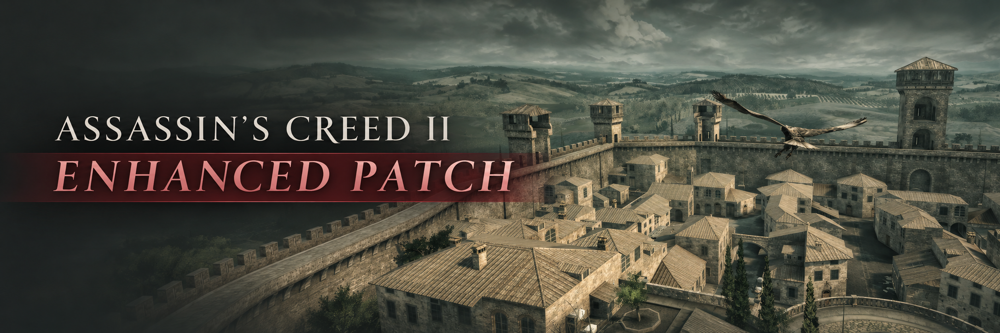
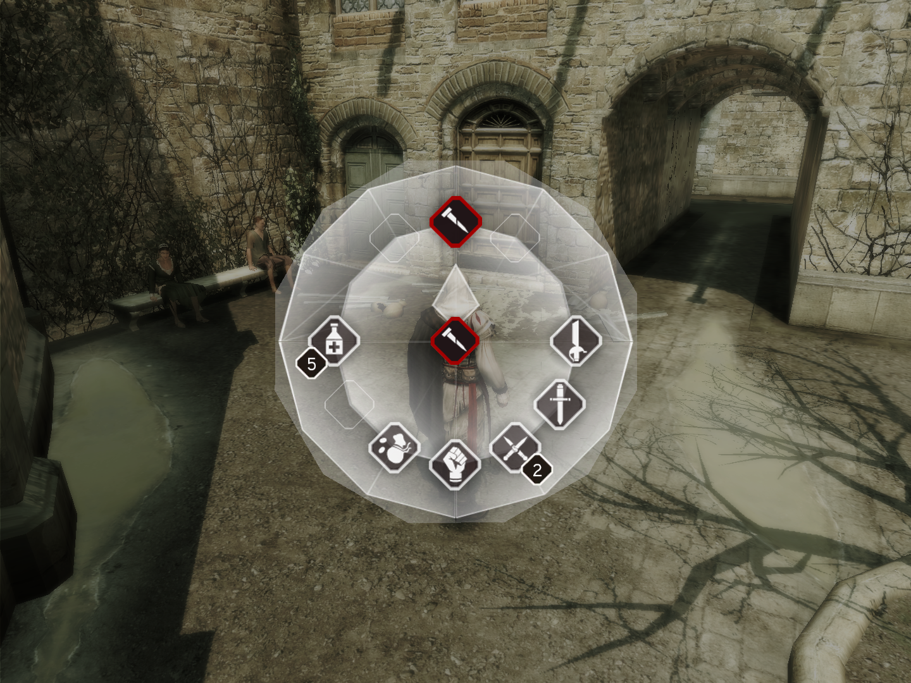

# Assassin’s Creed II Enhanced Patch

A community patch for the Windows Steam edition of Assassin’s Creed II. It adapts gameplay and the interface to your display, supports refresh rates above 60 Hz, and adds native integration for supported DualShock 4 and Xbox controllers.

[Download the latest release](https://github.com/XssentialPilar/Assassins-Creed-II-enhanced-patch/releases/latest) · [Installation](#installation) · [Compatibility](#compatibility)

## What the patch changes

- **Display and interface.** Gameplay fills the selected resolution. HUD elements retain their proportions, the minimap fills its frame, and the shop and weapon-wheel overlays extend to the screen edges.
- **Pre-rendered video.** Videos retain their original proportions. Their surrounding backgrounds extend to fill the display.
- **High refresh rates.** Selecting a refresh rate above 60 Hz removes the game’s internal 60 FPS wait. Your display settings, VSync, and system performance still affect the frame rate you see.
- **Controller support.** The patch identifies supported DualShock 4 and Xbox controllers, selects their button icons, and forwards the game’s vibration commands to both motors.

## In-game screenshots

*Monteriggioni at 1920 × 1200 (16:10). The action prompts and minimap align with the right side of the display.*

| Action prompts and minimap at 1920 × 1200 | Weapon wheel overlay at 1440 × 1080 |
| --- | --- |
|  |  |

## Installation

The patch supports Steam app **33230**, Windows build **1843459**.

1. Close the game, then download the Windows ZIP under **Assets** on the [latest release page](https://github.com/XssentialPilar/Assassins-Creed-II-enhanced-patch/releases/latest).
2. In your Steam Library, right-click the game and choose **Manage → Browse local files**. If the folder already contains `d3d9.dll` or `SDL3.dll`, please back up those copies outside the game folder.
3. Extract `d3d9.dll` and `SDL3.dll` beside `AssassinsCreedIIGame.exe`. Launch through Steam and choose your resolution and refresh rate in the game’s graphics settings.

The release includes a SHA-256 checksum. To verify your download in PowerShell, run `Get-FileHash .\AC2-Enhanced-Patch-v1.0.0-win32.zip -Algorithm SHA256` and compare the result with the accompanying `.sha256` file.

### Uninstall

Close the game, remove the two DLLs you installed from the ZIP, and restore any copies you backed up. The patch leaves the game executable, saves, and settings intact.

## Compatibility

| Area | Verification |
| --- | --- |
| Gameplay | Checked in-game at **1920 × 1200 (16:10)** and **1440 × 1080 (4:3)**. |
| Aspect ratios | Automated geometry tests also cover **16:9**, **3:2**, **5:4**, **4:5**, **2:1 (18:9)**, **21:9**, **2.375:1**, **1.85:1**, **2.35:1**, **2.39:1**, **2.40:1**, **2.76:1**, **9:16**, **19.5:1**, and **20:9**. |
| Controllers | Virtual-device tests cover switching between families, button icons, reconnection, and independent sustained vibration. Physical USB and Bluetooth validation is pending. |

### Troubleshooting

- **Another mod uses `d3d9.dll`.** Both mods use the same filename in the game directory. Keep a backup and choose which DLL to load.
- **The controller shows a different family’s icons.** The patch uses the controller identity exposed to Windows. If your input software presents a virtual controller, try letting Windows see the controller directly.
- **The game stays close to 60 FPS.** Check that the selected refresh rate in the game exceeds 60 Hz. Also check VSync and any frame limit set in the graphics driver or an overlay.

If you encounter a problem, please include the game build, resolution, and refresh rate. For controller reports, please also include the model and connection type. Local diagnostics are available in `%TEMP%\ac2-display-trace-*.csv`. [Report an issue](https://github.com/XssentialPilar/Assassins-Creed-II-enhanced-patch/issues)

[Build and test](BUILD.md) · [MIT license](LICENSE) · [Third-party notices](THIRD_PARTY.md)

Assassin’s Creed II is a Ubisoft game. This community project is independent.
