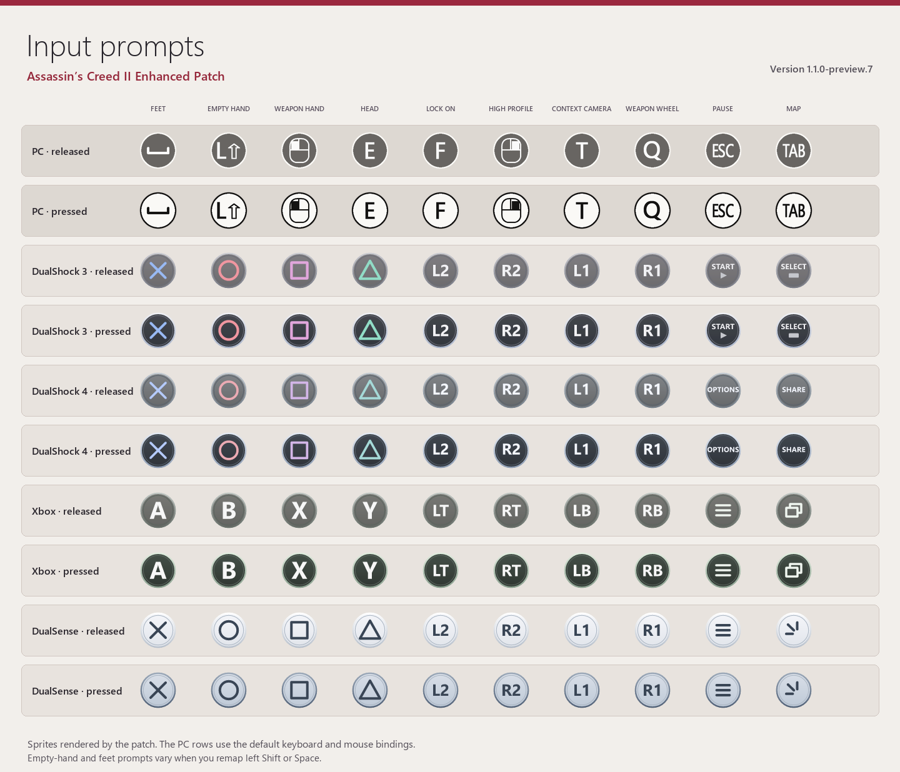
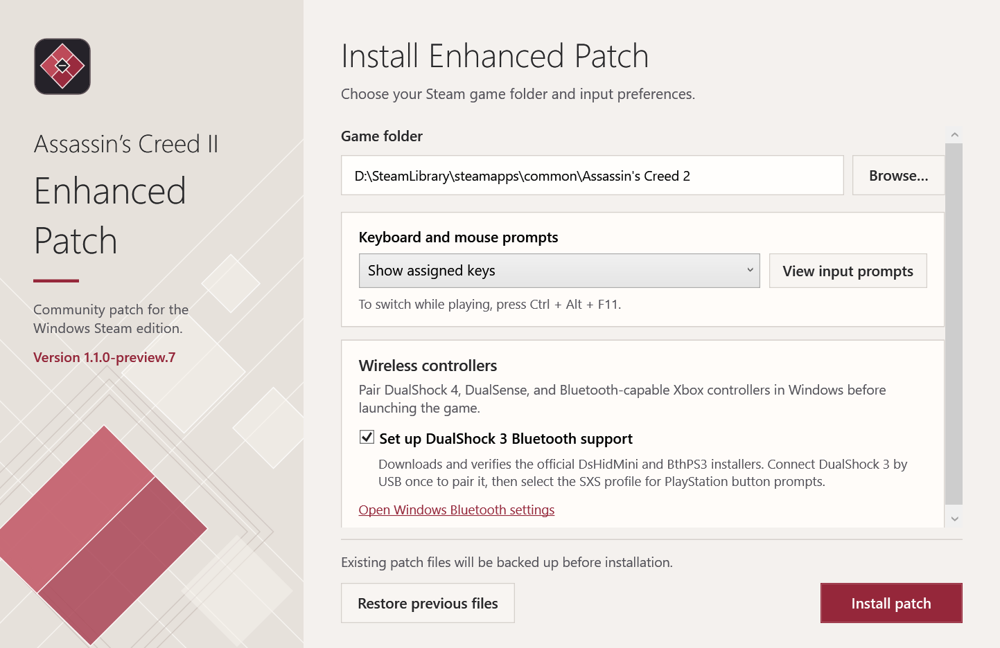

This preview adds the Windows installer, introduces input artwork for five device families, and expands PlayStation controller support. It targets **Assassin’s Creed II on Steam for Windows**, app **33230**, build **1843459**.

## Input prompts

- Keyboard and mouse prompts display your assigned controls in supported menus and in the gameplay action HUD. The round prompts have a translucent dark background at rest and turn white when pressed. Press **Ctrl + Alt + F11** in-game to switch to or from the original icons.
- DualShock 3, DualShock 4, Xbox, and DualSense each have distinct artwork with released and pressed states. The patch selects the artwork using the device identity reported by Windows.
- The installer’s **View input prompts** button shows the artwork from the bundled build. The installer also lets you choose your preferred PC prompt mode.

## Controller feedback

The patch uses the game’s two vibration levels for feedback. DualShock 4 and DualSense use a warm white light bar with a brief carmine accent for strong effects. The preview also adds DualSense trigger resistance and generated haptic feedback over USB and Bluetooth.

The optional DualShock 3 setup verifies and installs the required driver packages. Connect an official DualShock 3 over USB once for pairing, then select the **SXS** profile. Pair DualShock 4, DualSense, and Bluetooth-capable Xbox controllers in Windows before launching the game. [Controller setup details](https://github.com/XssentialPilar/Assassins-Creed-II-enhanced-patch/tree/v1.1.0-preview.7#playstation-controllers)

## Install

Please close the game and choose either ZIP under **Assets**.

- **Windows setup.** Extract `AC2-Enhanced-Patch-v1.1.0-preview.7-Setup-win-x64.zip` and run the versioned setup executable. Confirm the Steam game folder and select **Install patch**. Use **Restore previous files** to restore your previous installation.
- **Manual installation.** Extract the two DLLs from `AC2-Enhanced-Patch-v1.1.0-preview.7-win32.zip` beside `AssassinsCreedIIGame.exe`. Back up any existing copies of those DLLs first. To remove the patch, close the game and restore your backups or remove the DLLs you added.

Each ZIP includes an accompanying SHA-256 checksum under **Assets**.

## Testing and feedback

The new PC prompts were checked in gameplay, and the installer was tested for installation, repeat installation, and restoration. Automated tests covered display geometry, video fitting, virtual controller input and rumble, DualSense report generation, and the installed artwork. Physical controller testing over USB and Bluetooth remains open.

Thank you for trying this preview. If you encounter a problem, please include your resolution, refresh rate, and game build. For controller reports, please include the controller model and how it was connected. [Read the full guide](https://github.com/XssentialPilar/Assassins-Creed-II-enhanced-patch/tree/v1.1.0-preview.7) · [Report an issue](https://github.com/XssentialPilar/Assassins-Creed-II-enhanced-patch/issues)
